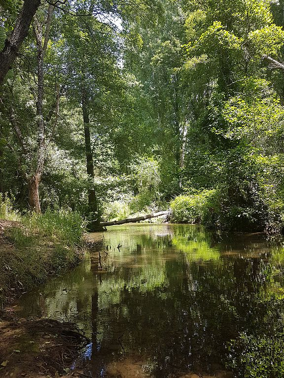

== Posibles localizaciones

// Describir lugar y poner alguna foto. ¡Ojo!

=== Rivera del Huéznar

Bonito lugar en la Sierra Norte de Sevilla.

.Ribera del río Huéznar a su paso por La Fundición. https://commons.wikimedia.org/wiki/File:Ribera_del_Hueznar_01.jpg[Créditos].

